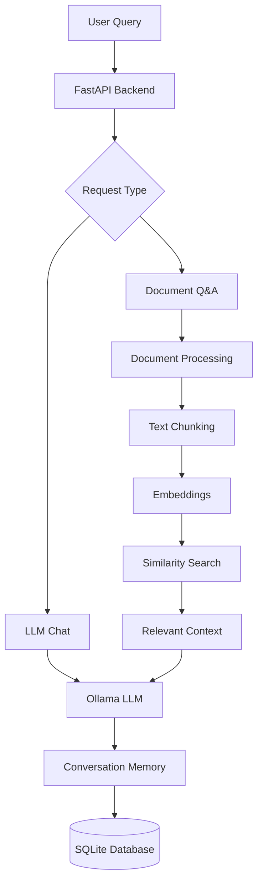

 <div align="center">


# Hello, I'm Madhavan 👋

### Data Science & Generative AI Developer


<p>
  
  
</p>

**Building intelligent solutions with Data Science, Machine Learning, and Generative AI.**

</div>

---

## 01 / ABOUT ME

I'm a BCA graduate currently pursuing my MCA, with a strong interest in building practical applications using Data Science and Generative AI.

I enjoy exploring how AI models work and turning concepts into working projects.

- 🤖 Exploring Generative AI, LLMs, and AI-powered applications.
- 🧠 Building RAG systems and experimenting with embeddings.
- 🐍 Working with Python, FastAPI, SQL, and Machine Learning.
- 🔍 Interested in understanding how AI systems work behind the scenes.
- 🚀 Focused on developing practical projects and growing as an AI developer.

**My goal:** Build useful AI applications and grow into a Generative AI / AI-ML engineering role.

---

## 02 / FEATURED PROJECTS

<div align="center">

<table>
<tr>
<td width="50%" valign="top">

### 🤖 AI Knowledge & Creation Platform

An AI-powered application built around LLM interaction and document-based question answering.

**What it includes**
- FastAPI backend
- Ollama local LLM integration
- Conversation memory with SQLite
- PDF upload and text extraction
- Document chunking and embeddings
- Semantic similarity search
- RAG-based answers with source references

**Technologies**

`Python` `FastAPI` `Ollama` `SQLite` `RAG`

**Status:** In development

<a href="https://github.com/madhavan0409/ai-data-portfolio">
  
</a>

</td>
<td width="50%" valign="top">

### 📊 Diabetes Prediction

A machine learning project exploring diabetes-related data and predictive modelling.

**What it includes**
- Data exploration and analysis
- Data preprocessing
- Feature analysis
- Machine learning modelling
- Model evaluation

**Technologies**

`Python` `Pandas` `Scikit-learn` `Matplotlib`

<a href="https://github.com/madhavan0409/diabetes-ds">
  
</a>

</td>
</tr>
<tr>
<td width="50%" valign="top">

### 🧪 AI Portfolio

A repository for showcasing my learning, experiments, and development in AI and Data Science.

<a href="https://github.com/madhavan0409/AI_portfolio">
  
</a>

</td>
<td width="50%" valign="top">

### 💻 Git Learning

A repository documenting my learning and practice of Git and GitHub fundamentals.

<a href="https://github.com/madhavan0409/git-learning">
  
</a>

</td>
</tr>
</table>

</div>

---

## 03 / TECHNOLOGY ARSENAL

### Programming & Development

<p>

</p>

### AI / ML & Data Science

<p>


</p>

### Generative AI & LLM

<p>


</p>

### Backend & Databases

<p>


</p>

### Analytics & Visualization

<p>


</p>

---

## 04 / PROJECT ARCHITECTURE

### AI Knowledge & Creation Platform

The following diagram illustrates the core backend and RAG workflow currently implemented in the project.



---

## 05 / CURRENTLY EXPLORING

| Area | Focus |
|---|---|
| Generative AI | LLMs, prompt engineering, model integration |
| RAG | Retrieval, chunking, embeddings, retrieval quality |
| Vector Databases | Vector storage and similarity search |
| AI Agents | Tool usage, automation, agent workflows |
| Machine Learning | Model development and evaluation |
| Backend Engineering | FastAPI, APIs, application architecture |
| Deployment | Testing, deployment, and cloud fundamentals |

---

## 06 / LEARNING PRIORITIES

```text
01  Generative AI Engineering
    ├── LLM integration
    ├── Prompt engineering
    └── Model workflows

02  Advanced RAG
    ├── Retrieval strategies
    ├── Vector databases
    └── RAG evaluation

03  AI Agents & Automation
    ├── Tool calling
    ├── Agent workflows
    └── Task automation

04  Machine Learning Engineering
    ├── Model development
    ├── Model evaluation
    └── Experiment tracking

05  Production & Cloud
    ├── Testing
    ├── Deployment
    └── Cloud fundamentals
```

---

## 07 / EDUCATION

🎓 **Bachelor of Computer Applications (BCA)**

Graduated

🎓 **Master of Computer Applications (MCA)**

Currently pursuing — Distance Education

---

## 08 / GITHUB ANALYTICS

<div align="center">


</div>

---

## 09 / BEYOND CODING

When I'm away from the keyboard, you'll probably find me:

- 💪 Strength training and fitness
- 🚴 Cycling and exploring
- 🧠 Learning about emerging technologies
- 🔬 Experimenting with new tools and ideas

---

## 10 / LET'S CONNECT

<div align="center">

<a href="https://github.com/madhavan0409">

</a>

<a href="https://www.linkedin.com/">

</a>

<br/>

### Building. Experimenting. Learning.

**Build. Experiment. Learn. Repeat.**


</div>
